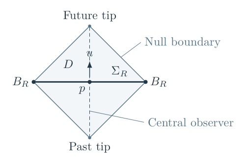
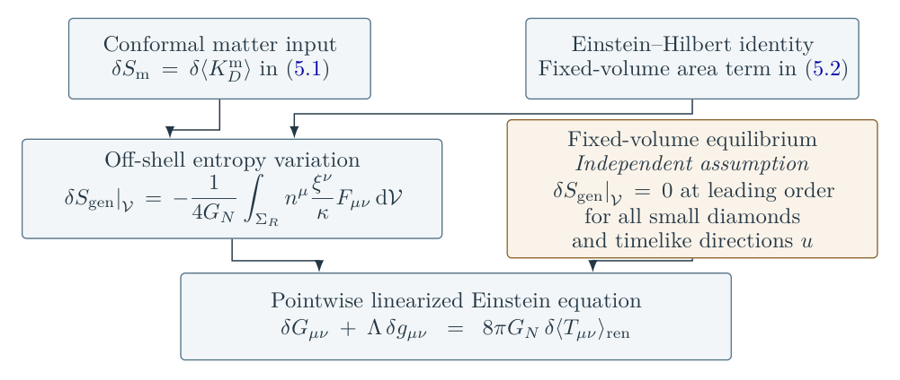

# Type II₁ Operator-Algebra Quantum Error Correction for a de Sitter Causal Diamond

*A Speculative Perspective on a Holographic Universe*

**Murat Durmus** · [Read the manuscript (PDF)](paper/manuscript.pdf) · [LaTeX source](paper/manuscript_de_sitter_oaqec_implications.tex)

If you’d like the simplest explanation of the paper, start with the [one-page summary in German and English (PDF)](paper/de-sitter-oaqec-einfach-erklaert-de-en.pdf).

## Author’s preface

Is it reasonable for someone who studied computer science and philosophy, and whose interest in theoretical physics spans twenty years, to write and publish a paper like this with the help of AI? I have asked myself that question throughout this project.

I could not have formulated the equations in this manuscript on my own. I relied on AI for that work and for help with several of the more specialized technical points. My starting point was philosophical. I wanted to give my speculative ideas about spacetime and holography a more precise form and see how much support the mathematics could offer them.

I cannot say with confidence whether I succeeded or whether the work has scientific or philosophical value. That is for readers with deeper expertise in the relevant fields to assess. I would welcome constructive criticism, especially of the assumptions, the mathematical arguments, and the interpretation of the results.

## Overview

The paper studies exact reconstruction in an abstract model of a single **causal diamond** on a fixed de Sitter background. A causal diamond is the region determined by a ball on a spatial slice. The paper also asks what physical input would be needed to connect the model to gravity.

## The algebraic construction

- **A finite algebra for one diamond.** Starting with the local quantum field algebra, the paper takes its crossed product by the vacuum modular flow and compresses to the positive-energy sector of an observer clock. The resulting type II₁ factor has a normalized trace.
- **Exact reconstruction in a tracial extension.** An explicit inclusion reconstructs the left and right actions in the standard representation and preserves relative entropy. All logical information stays in the diamond factor, so the model can tolerate discarding the auxiliary matrix factor. A result based on Takesaki’s theorem rules out the particular embedding into the static-patch core that identifies both the field operators and clock unitaries.
- **A clock counterexample.** The algebraic entropy can change to first order even when both the relative entropy at the reference state and the clock's own entropy are stationary. A physical equilibrium argument must account for changes in the observer's energy.

## The conditional link to gravity

The paper summarizes the Jacobson–Visser small-diamond argument for conformal matter on a fixed de Sitter background. Given the Einstein area term and fixed-volume entanglement equilibrium for all small diamonds and timelike directions, the variational identity yields the linearized semiclassical Einstein equation. Connecting this argument to the algebraic model would require a gravitational constraint relating changes in the observer’s energy to changes in the area at fixed volume.

## A speculative holographic perspective

Could a common quantum structure give rise to the local observations of different observers and, eventually, to a shared spacetime description? The final section sketches that possibility. Agreement on overlapping observables would be a consistency requirement. A holographic realization would also need a physically defined lower-dimensional theory that recovers the interior observables and their dynamics.

The algebraic example illustrates exact reconstruction using the diamond algebra itself. A horizon realization and the emergence of the geometry remain speculative. The paper relates these open questions to Bohm’s implicate order and Pribram’s work on distributed representation. It also proposes a machine-learning experiment on recovering task-relevant features after masking parts of a model’s representation.

## AI implications

I see three possible directions for AI research that we can draw from this paper.

**Robustness.** If part of a model is switched off, can it still do a specific task? I’d compare a feature-recovery training objective with standard dropout and with an otherwise identical model trained using the same masks and the ordinary task loss. I’d test all three on failures they haven’t seen before.

**Interpretability.** Where can we recover a piece of information inside a model, and does the model actually use it? Masking and restoring groups of activations lets us test whether that information changes the answer.

**Shared world models.** More speculatively, could a model’s image and language modules agree about the same scene when each has only part of the information? For example, could both tell which object is in front of the other?

## Build the manuscript

The manuscript uses LaTeX, BibTeX, and TikZ. With a TeX distribution that includes these packages and latexmk, run:

~~~sh
cd paper
latexmk -pdf manuscript_de_sitter_oaqec_implications.tex
~~~

The [bibliography](paper/references_de_sitter_oaqec_implications.bib) is included alongside the source. The figures in the LaTeX manuscript are drawn in TikZ. The README images are rendered from the included PDF.

## Key takeaways

- **Exact reconstruction in the model.** The type II₁ inclusion preserves relative entropy and gives exact reconstruction of the standard-form left and right actions. Its erasure protection covers the auxiliary factor.
- **Limits of the construction.** Identifying both sets of field operators and clock unitaries in an embedding into the static-patch core is obstructed. In the clock example, stationary relative entropy and stationary clock entropy coexist with changing algebraic entropy.
- **Conditional gravity.** The Jacobson–Visser argument yields the linearized semiclassical Einstein equation about de Sitter under independent area and fixed-volume equilibrium assumptions.
- **Speculative holography.** A lower-dimensional quantum description might account for compatible observations across different observers. Recovering a common spacetime and its dynamics remains open.
- **An AI analogy to test.** The paper proposes measuring whether selected features can be recovered after masking groups of activations in a classical model.
