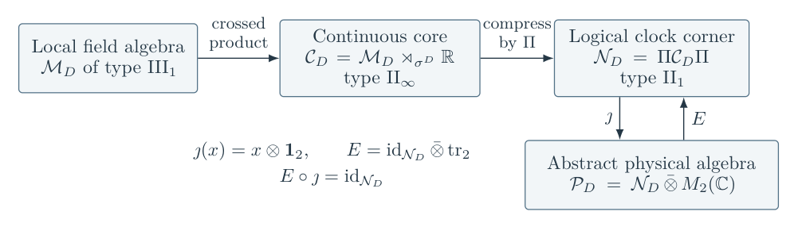
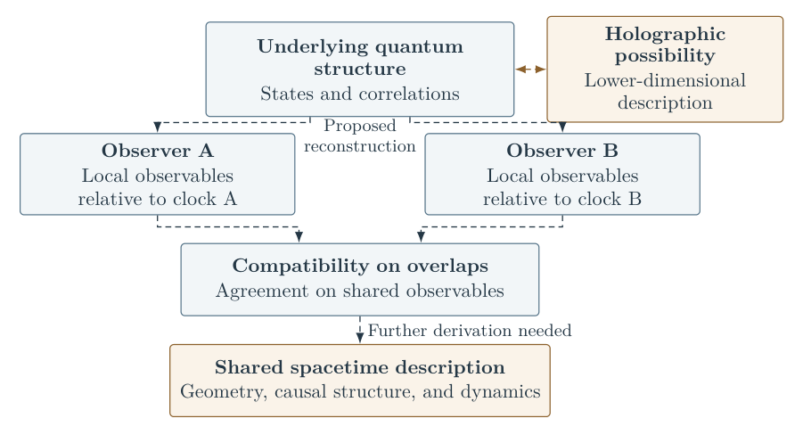

# Type II₁ Operator-Algebra Quantum Error Correction for a de Sitter Causal Diamond

*A Speculative Perspective on a Holographic Universe*

**Murat Durmus** · [Read the manuscript (PDF)](paper/manuscript.pdf) · [LaTeX source](paper/manuscript_de_sitter_oaqec_implications.tex)

## Author’s preface

Is it reasonable for someone who studied computer science and philosophy, and whose interest in theoretical physics spans twenty years, to write and publish a paper like this with the help of AI? I have asked myself that question throughout this project.

I could not have formulated the equations in this manuscript on my own. I relied on AI for that work and for help with several of the more specialized technical points. My starting point was philosophical. I wanted to give my speculative ideas about spacetime and holography a more precise form and see how much support the mathematics could offer them.

I cannot say with confidence whether I succeeded or whether the work has scientific or philosophical value. That is for readers with deeper expertise in the relevant fields to assess. I would welcome constructive criticism, especially of the assumptions, the mathematical arguments, and the interpretation of the results.

## Overview

The paper asks how much of a local quantum description in de Sitter spacetime can be reconstructed exactly, and what additional assumptions are needed to connect that reconstruction to gravity. Its starting point is a single **causal diamond**, the region determined by a ball on a spatial slice.

## The algebraic construction

- **A finite algebra for one diamond.** Starting with the local quantum field algebra, the paper takes its crossed product by the vacuum modular flow and compresses to the positive-energy sector of an observer clock. The resulting type II₁ factor has a normalized trace.
- **Exact recovery in a tracial extension.** An explicit inclusion code reconstructs the logical algebra and its commutant and preserves relative entropy. The construction uses an auxiliary matrix factor. The paper also identifies an obstruction to the natural embedding into the static patch that would preserve both the field inclusion and the clock unitaries.
- **A clock counterexample.** The algebraic entropy can change to first order even when both the relative entropy at the reference state and the clock's own entropy are stationary. A physical equilibrium argument must account for changes in the observer's energy.

## The conditional link to gravity

For conformal matter, the paper combines the matter first law with the Einstein–Hilbert variational identity for a causal diamond. **If** generalized entropy is stationary at fixed volume for all sufficiently small diamonds and timelike directions, the linearized semiclassical Einstein equation follows around the chosen de Sitter background. The diagram highlights the role of this independent equilibrium assumption.

## A speculative holographic perspective

Could a common quantum structure give rise to the local observations of different observers and, eventually, to a shared spacetime description? The final section sketches that possibility. Agreement on overlapping observables would be a consistency requirement. A holographic realization would also need a physically defined lower-dimensional theory that recovers the interior observables and their dynamics.

The paper gives a concrete reconstruction example for one diamond and a conditional link between entropy balance and curvature. These results offer limited theoretical support for the plausibility of a holographic description. The proposed horizon realization and emergence of the geometry remain open. The discussion relates this distinction to Bohm's implicate order and Pribram's work on distributed representation. It also proposes a separate machine-learning experiment on recovering task-relevant features after masking parts of a model's representation.

## Build the manuscript

The manuscript uses LaTeX, BibTeX, and TikZ. With a TeX distribution that includes these packages and latexmk, run:

~~~sh
cd paper
latexmk -pdf manuscript_de_sitter_oaqec_implications.tex
~~~

The [bibliography](paper/references_de_sitter_oaqec_implications.bib) is included alongside the source. The figures in the LaTeX manuscript are drawn in TikZ. The README images are rendered from the included PDF.

## Key takeaways

- **Exact reconstruction for one diamond.** Under the stated assumptions, a type II₁ tracial inclusion code gives complementary reconstruction and preserves relative entropy.
- **Limits of the construction.** The natural vacuum-compatible embedding into the static patch is obstructed. In the clock example, stationary relative entropy and stationary clock entropy coexist with changing algebraic entropy.
- **Conditional gravity.** For conformal matter, the Einstein–Hilbert variational identity and fixed-volume entanglement equilibrium across small diamonds yield the linearized semiclassical Einstein equation around de Sitter.
- **Speculative holography.** A lower-dimensional quantum description might account for compatible observations across different observers. Recovering a common spacetime and its dynamics remains open.
- **An AI analogy to test.** The paper proposes measuring whether selected features can be recovered after masking groups of activations in a classical model.
